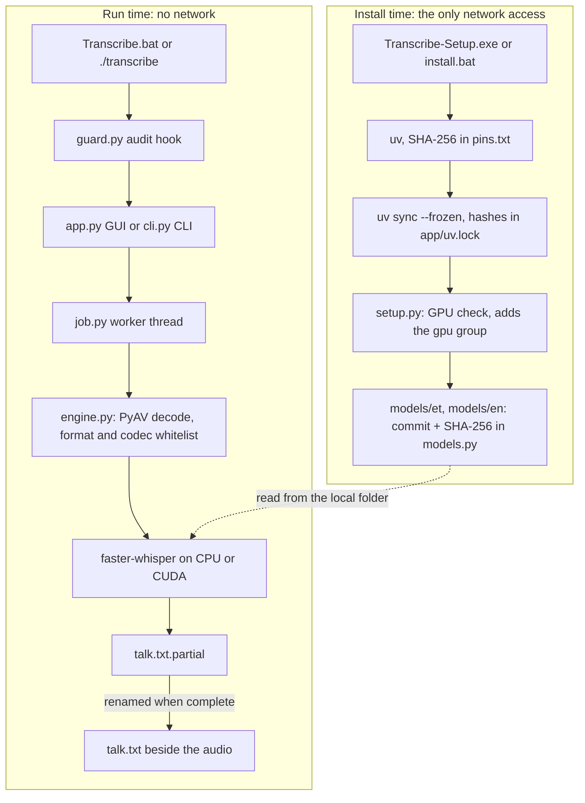

# Architecture

Setup runs once per folder. `Transcribe-Setup.exe` (built from `installer/Setup.cs`) and `install.bat` do
the same steps: fetch uv, check its hash against `pins.txt`, install the locked Python and libraries, then
run `python -m transcribe_offline.setup`. That module asks `nvidia-smi` about the GPU, adds the locked
`gpu` dependency group when the card qualifies, and downloads each model file with its hash checked.

At run time `__main__.py` installs `guard.py` before importing anything else. The GUI and the CLI share
one job runner. `engine.py` opens the audio with PyAV, allowing only local files and a fixed list of
containers and decoders, then hands the samples to faster-whisper. The transcript is written to
`<name>.txt.partial` and renamed to `<name>.txt` only when it is complete, so a cancel or crash never
leaves a half-written `.txt`. If CUDA fails, the job reloads the model on the CPU.

## Decisions

| Decision | Rejected alternative |
|---|---|
| Rewrite the GUI path of stt-faster from scratch, keeping only what this app needs. | Generating an export from stt-faster, or sharing a core library with it. Both keep stt-faster's extension points, which a reviewer would have to read. |
| Pin every install-time download: uv by SHA-256, libraries by `uv.lock` hashes, models by commit and SHA-256. No "latest" lookups, no self-update. | A single offline bundle of several GB. |
| On Windows the extracted folder is the install. Setup needs no admin rights and writes nothing outside it. | Copying the app into `%LOCALAPPDATA%`. |
| `setup.py` downloads models with the standard library from explicit `huggingface.co/<repo>/resolve/<commit>/<file>` URLs; the app loads them from a folder path. | `huggingface_hub.snapshot_download`, which builds its own URLs and keeps a cache outside the folder. |
| GPU detection runs in `setup.py`, in Python with unit tests. | Detecting in `Setup.cs` and `install.bat`. That changes the exe hash, which resets its SmartScreen reputation, and puts the same logic in C# and batch with no tests. |
| A small C# installer, `Transcribe-Setup.exe`, with fixed logic and pins read from `pins.txt`, so its hash stays the same across releases. `install.bat` remains as a fallback. | `install.bat` alone. App Control on a managed Windows 11 PC blocked `.bat` files downloaded from the internet. |
| Ban Tcl's `.call` and `.eval` by name in runtime modules (`app/tests/test_imports.py`), next to the ruff `TID251` import ban. | Hiding Tcl's `exec` and `socket` commands inside the interpreter. `interp invokehidden` reaches hidden commands in one line. |

The guard and the import ban only cover Python. What they leave open, native code such as FFmpeg
included, is in [SECURITY.md](../SECURITY.md).
